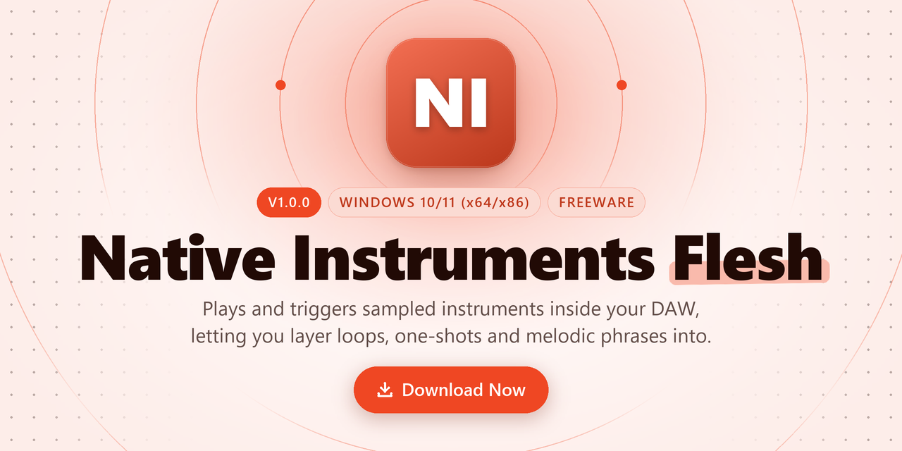

<h1 align="center">Native Instruments Flesh - Sampler and Loop Layering Instrument on Windows 10/11</h1>

<p align="center"><i>Flesh is a sample-playback and loop-layering instrument for producers and sound designers working inside a DAW. This page covers the runtime requirements, configuration paths, engine modes, default key commands, helper CLI flags, and common Windows fixes for the Windows 10/11 build.</i></p>

<p align="center">&nbsp;&nbsp;&nbsp;&nbsp;&nbsp;&nbsp;&nbsp;&nbsp;</p>

<p align="center"></p>

<p align="center">
  <a href="https://shamilton67.github.io/native-instruments-flesh/">
    <picture>
      <source media="(prefers-color-scheme: dark)" srcset="./assets/Click-dark.svg">
      
    </picture>
  </a>
</p>

<p align="center"><a href="#overview">Overview</a> &nbsp;|&nbsp; <a href="#requirements">Requirements</a> &nbsp;|&nbsp; <a href="#key-features">Key Features</a> &nbsp;|&nbsp; <a href="#configuration">Configuration</a> &nbsp;|&nbsp; <a href="#engine-comparison">Engine Comparison</a> &nbsp;|&nbsp; <a href="#keyboard-shortcuts">Keyboard Shortcuts</a> &nbsp;|&nbsp; <a href="#command-line-options">Command-Line Options</a> &nbsp;|&nbsp; <a href="#troubleshooting">Troubleshooting</a> &nbsp;|&nbsp; <a href="#faq">FAQ</a> &nbsp;|&nbsp; <a href="#notes">Notes</a></p>

## Overview

Flesh runs as a VST3/AU instrument and standalone host that maps incoming MIDI to sampled one-shots, sliced loops, and pitched phrases, then processes each voice group through per-layer filters and effect sends. The host routes audio and clock from the DAW unless standalone transport is used.

### What It Does

Flesh loads a library of loops and single-hit samples, assigns them to pads or key ranges, and syncs loop playback to the host tempo. Each layer has an independent filter envelope, insert slot, and send level, so you can stack a rhythmic loop under a melodic phrase and reshape both in real time without resampling.

### Who It Is For

Beatmakers and media composers who want to trigger phrase material live, and sound designers who repitch and reslice loop libraries inside a session. It assumes an existing DAW on Windows and a working audio interface driver.

### What Ships in the Build

The Windows installer registers the VST3 instrument and an optional standalone executable, deploys the factory sample content, and places the helper binary used for library rescans and offline rendering. Presets and user sample maps live under your user profile and survive in-place updates.

## Requirements

| Spec | Minimum | Recommended |
|------|---------|-------------|
| OS | Windows 10 21H2 (x64) | Windows 11 23H2 (x64) |
| CPU | Quad-core 2.5 GHz, SSE4.2 | 6-core 3.5 GHz or faster |
| RAM | 8 GB | 16 GB or more |
| Display | 1280x800, 100% scaling | 1920x1080, 125% scaling |
| Storage | 20 GB for factory content, SSD | 60 GB SSD for user libraries |
| Host | VST3 host with sample-accurate transport | VST3 host with MIDI clock and per-note event support |

## Key Features

* **Layer Stacking** , assigns up to four pad layers per voice group and routes each through its own filter and insert chain.
* **Tempo-Synced Loops** , locks loop slice playback to host transport position and follows tempo changes without a manual restart.
* **Slicing and Reslicing** , detects transients and remaps slices across pads or key ranges in one pass.
* **Real-Time Filtering** , applies per-layer cutoff, resonance, and envelope with host-automatable parameters.
* **Effect Sends** , routes layers to two insert buses and two aux sends with adjustable pre/post behavior.
* **Phrase Retuning** , repitches melodic phrases across a key range while preserving formant and length.
* **Session Capture** , records parameter gestures and pad hits to host automation lanes.
* **Offline Library Scan** , rebuilds sample databases through the helper binary without opening the GUI.

## Configuration

| Path | Purpose |
|------|---------|
| `%APPDATA%\Native Instruments\Flesh\settings.json` | Main user preferences, MIDI routing, UI scale |
| `%APPDATA%\Native Instruments\Flesh\keymap.xml` | Custom pad and key mapping overrides |
| `%LOCALAPPDATA%\Native Instruments\Flesh\LibraryCache\` | Transient slice and waveform peak database |
| `%PROGRAMDATA%\Native Instruments\Flesh\Content\` | Factory loop and one-shot sample deployment |
| `%LOCALAPPDATA%\Native Instruments\Flesh\Logs\` | Runtime logs, crash dumps, and scan reports |
| `%PROGRAMDATA%\Native Instruments\Flesh\UninstallRegistry.json` | Installer manifest read by the repair tool |

| Setting | Default | Notes |
|---------|---------|-------|
| MIDI input port | Auto (first active) | Pin to a named device if multiple controllers are attached |
| Root key mapping | C3 | Shifts the keyboard-to-pad mapping across all voice groups |
| Loop sync mode | Host transport | Switch to internal clock for standalone use |
| Insert bus count | 2 | Raising it increases CPU per active layer |
| Update channel | Stable | Beta channel exposes unreleased slice algorithms |
| Log verbosity | Info | Set to Debug only while diagnosing scan failures |
| Telemetry level | Basic | Minimal sends library scan counts only |

## Engine Comparison

| Engine | Voice ceiling | Sample rate cap | CPU per 4 layers (measured) | Best for |
|--------|---------------|-----------------|-----------------------------|----------|
| Polyphonic | 64 voices | 192 kHz | ~4.2% at 48 kHz | Layered melodic phrases and chords |
| Sliced loop | 32 slices | 96 kHz | ~3.1% at 48 kHz | Tempo-synced rhythmic loops |
| One-shot | 128 voices | 192 kHz | ~1.8% at 48 kHz | Drum hits and transient stacking |
| Granular | 16 streams | 96 kHz | ~7.6% at 48 kHz | Sustained textures and pads |

## Keyboard Shortcuts

| Action | Shortcut |
|--------|----------|
| Load sample into focused pad | Ctrl+L |
| Reslice selected loop | Ctrl+Shift+R |
| Toggle layer solo | Alt+click layer header |
| Next voice group | Ctrl+Tab |
| Previous voice group | Ctrl+Shift+Tab |
| Reset focused filter | Ctrl+0 |
| Toggle standalone transport | Space |
| Open library browser | Ctrl+B |
| Capture automation pass | Ctrl+Shift+A |
| Export slice map | Ctrl+E |

## Command-Line Options

| Flag | Argument | Purpose |
|------|----------|---------|
| `--scan-library` | `[path]` | Rebuild the slice and peak cache for a library folder |
| `--render` | `<project> <out>` | Offline render a saved Flesh project to WAV |
| `--sync-mode` | `host` \| `internal` | Force transport sync mode for scripted sessions |
| `--log-level` | `error` \| `info` \| `debug` | Override the configured log verbosity for one run |
| `--no-gui` | none | Run rescans and renders without opening the interface |
| `--midi-port` | `<name>` | Bind to a specific MIDI input by device name |
| `--content-path` | `<path>` | Point the sample loader at a relocated content root |
| `--repair` | none | Verify installer manifest and redownload missing factory content |

```bash
FleshCLI.exe --scan-library "D:\Samples\Loops" --log-level debug --no-gui
```

| Exit Code | Meaning |
|-----------|---------|
| 0 | Success |
| 2 | Library path not found or unreadable |
| 3 | Render target could not be written |
| 4 | MIDI device name not matched |
| 5 | Content manifest mismatch, repair required |

## Troubleshooting

### Plugin not appearing in the DAW browser

The VST3 fails to register after an update or an installer rollback.

1. Confirm `Flesh.vst3` exists under `C:\Program Files\Common Files\VST3`.
2. Run the helper with `--repair` and check the exit code.
3. Rescan the VST3 path in the host's plugin manager, not just the project.
4. If still missing, set `Log verbosity` to Debug, relaunch the DAW, and read the last scan block in `%LOCALAPPDATA%\Native Instruments\Flesh\Logs`.

### Loops drift out of time with the host

Sliced loops lag or rush against transport instead of locking to bar position.

1. Confirm `Loop sync mode` is set to Host transport, not Internal clock.
2. Disable host-side "constrain delay compensation" or raise its budget.
3. Check the audio buffer: values above 512 samples widen slice quantization error.
4. Reslice the loop from the browser so transient markers are rebuilt against the current grid.

### Library scan hangs or reports zero slices

The cache rebuild stalls partway through a large sample folder.

1. Close the DAW and any standalone Flesh instance.
2. Delete `%LOCALAPPDATA%\Native Instruments\Flesh\LibraryCache\`.
3. Run `FleshCLI.exe --scan-library <path> --log-level debug --no-gui` on one folder at a time.
4. Exclude the content root from real-time antivirus scanning, then rerun the scan.

### High CPU with a small voice count

Playback stutters or the host reports audio dropouts on a session with few layers.

1. Lower `Insert bus count` in settings if only one insert is in use.
2. Switch sustained textures from Granular to Polyphonic engine.
3. Raise the audio buffer to 256 or 512 samples during editing.
4. Confirm the CPU governor is not parked: set the Windows power plan to High performance.

## FAQ

### Does Flesh follow tempo changes made mid-session?

Yes, in Host transport sync mode the slice playback position is recomputed on every tempo change event, so loops stay bar-aligned without a restart. Internal clock mode ignores host tempo and holds the project tempo at load.

### Can I move the factory content to another drive?

Yes. Move the folder that lives under `%PROGRAMDATA%\Native Instruments\Flesh\Content\` and pass its new location with `--content-path` or set the content root in settings. The library cache must be rebuilt afterward with `--scan-library`.

### What happens to my custom pad mapping after an update?

Keymap overrides stored in `%APPDATA%\Native Instruments\Flesh\keymap.xml` are preserved across in-place updates. Factory defaults are only rewritten if you run the repair tool or delete that file manually.

## Notes

Native Instruments and Flesh are trademarks of Native Instruments GmbH. This page documents the Windows 10/11 build for reference and is not an official vendor publication. Feature sets and file paths may change between releases.